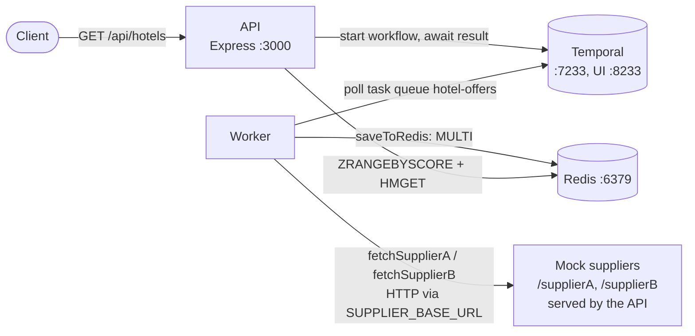
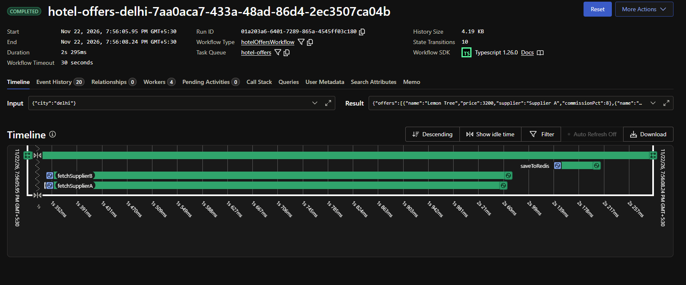
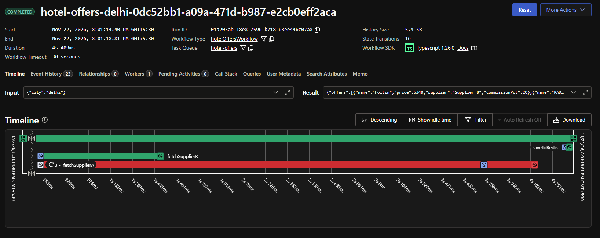
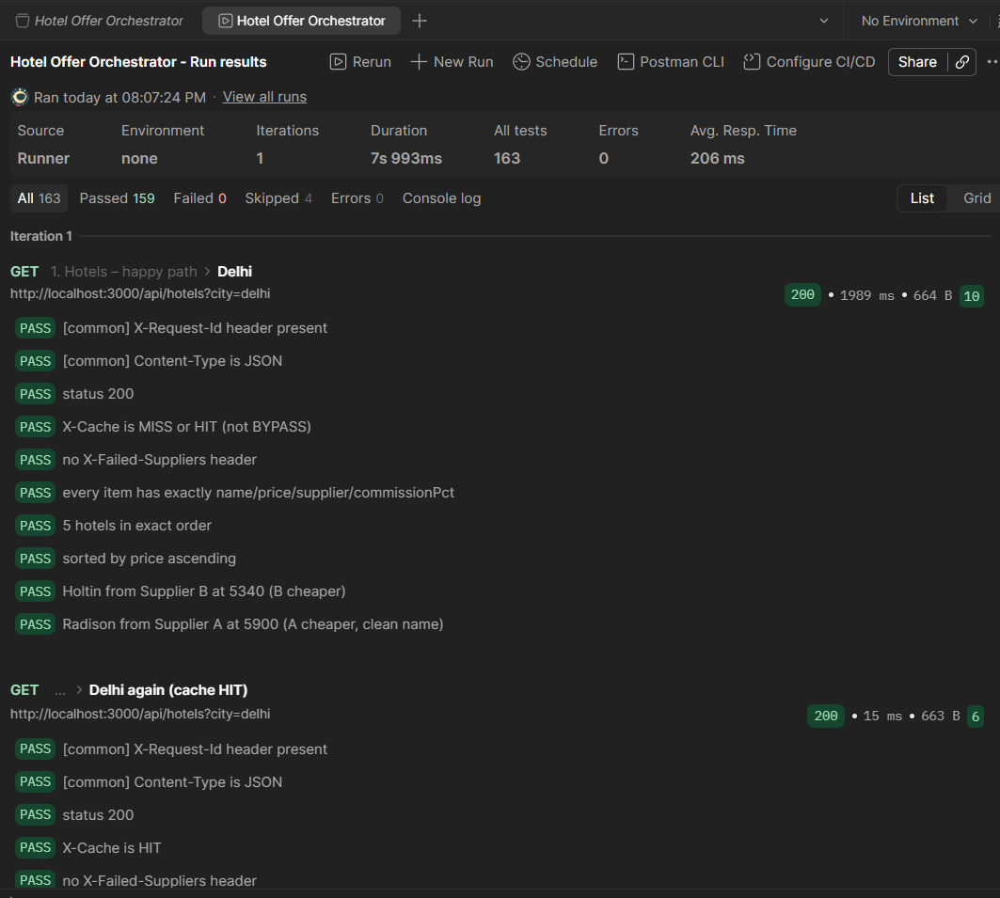

# Hotel Offer Orchestrator

An Express API that fetches hotel offers for a city from two suppliers at the same time, using a Temporal workflow. It removes duplicate hotels by name and keeps the cheaper offer, caches the result in Redis, and runs price filters inside Redis. Both suppliers are mocked by the same service, and you can switch either one off to see how the system handles partial and total failure.

**Stack:** Node.js 22 (TypeScript), Express 5, Temporal, Redis 7, Docker Compose.

## Quick start

You need Docker with Compose, and ports **3000, 6379, 7233 and 8233** must be free.

```bash
docker compose up -d --build
curl -i "http://localhost:3000/api/hotels?city=delhi"
```

| URL | What it shows |
|---|---|
| <http://localhost:3000/api/hotels?city=delhi> | Hotel offers for Delhi (also try `mumbai`, `&minPrice=5000&maxPrice=6000`) |
| <http://localhost:3000/health> | Health of both suppliers, Redis, Temporal and the worker |
| <http://localhost:8233> | Temporal Web UI: every request appears as a `hotel-offers-…` workflow |

Watch the logs with `docker compose logs -f api worker`. Stop everything with `docker compose down`.

## Contents

1. [Requirements checklist](#requirements-checklist)
2. [Architecture](#architecture)
3. [Request flow](#request-flow)
4. [API reference](#api-reference)
5. [Simulating a supplier being down](#simulating-a-supplier-being-down)
6. [Testing](#testing)
7. [Local development without Docker](#local-development-without-docker)
8. [Configuration](#configuration)
9. [Design decisions](#design-decisions)
10. [Screenshots](#screenshots)

Design details, the Redis data model and known limitations are in [docs/DESIGN.md](docs/DESIGN.md).

## Requirements checklist

| Requirement | Where |
|---|---|
| `GET /api/hotels?city=` starts a Temporal workflow | [src/api/routes/hotels.ts](src/api/routes/hotels.ts), [src/temporal/runner.ts](src/temporal/runner.ts) |
| Supplier A and B are called in parallel | [src/temporal/workflows.ts](src/temporal/workflows.ts) (`Promise.allSettled` over two activities) |
| Dedupe by name, keeping the cheaper offer | [src/domain/selectBestOffers.ts](src/domain/selectBestOffers.ts) |
| Deduped list saved in Redis | `saveToRedis` activity → [src/redis/hotelRepository.ts](src/redis/hotelRepository.ts) |
| `minPrice` / `maxPrice` filtered inside Redis | `ZRANGEBYSCORE` in [src/redis/hotelRepository.ts](src/redis/hotelRepository.ts) |
| Mock `/supplierA/hotels` and `/supplierB/hotels` | [src/api/routes/suppliers.ts](src/api/routes/suppliers.ts), [src/data/mockHotels.ts](src/data/mockHotels.ts) |
| Bonus: `/health` covering both suppliers | [src/api/routes/health.ts](src/api/routes/health.ts), [src/api/health.ts](src/api/health.ts) |
| Bonus: logging and error handling | pino ([src/logger.ts](src/logger.ts)), [src/temporal/activities.ts](src/temporal/activities.ts), [src/temporal/workflows.ts](src/temporal/workflows.ts), [src/api/errors.ts](src/api/errors.ts) |
| Dockerfile, docker-compose, Postman collection | [Dockerfile](Dockerfile), [docker-compose.yml](docker-compose.yml), [postman_collection.json](postman_collection.json) |

## Architecture



- **api**: Express server. It validates queries, reads from the Redis cache, starts workflows and serves the mock supplier endpoints.
- **worker**: Temporal worker. It runs the workflow and the three activities (`fetchSupplierA`, `fetchSupplierB`, `saveToRedis`).
- **temporal**: Temporal CLI dev server, a single process with the Web UI built in.
- **redis**: cache only, with snapshots and AOF turned off.

The api and worker are two processes built from one codebase and one Docker image. Only their start command differs.

## Request flow

**Cache miss** (`X-Cache: MISS`):

1. The API validates the query and normalizes `city` (trimmed, lowercased).
2. It looks up `hotels:{city}` in Redis. The key isn't there.
3. It starts workflow `hotel-offers-{city}-{uuid}` and waits for the result.
4. The workflow runs `fetchSupplierA` and `fetchSupplierB` in parallel. Each activity calls a mock endpoint over HTTP and retries up to 3 times.
5. The workflow dedupes the offers (cheaper wins, a price tie goes to Supplier A) and sorts them by price.
6. `saveToRedis` writes the list atomically: TTL 300s, or 30s if a supplier failed.
7. The API reads the list back from Redis with `ZRANGEBYSCORE` using the requested bounds, so filtering always happens in Redis.

**Cache hit** (`X-Cache: HIT`): step 2 finds the key, and the API answers from Redis without starting a workflow.

**`X-Cache: BYPASS`**: Redis was unavailable. The API returns the live workflow result, which is only possible when there's no price filter.

**`X-Failed-Suppliers: Supplier A`**: sent only when a supplier failed. The value is stored with the cached list, so cache hits keep reporting it until the 30s TTL expires.

### Failure modes

| Situation | Response | Notes |
|---|---|---|
| One supplier fails (after 3 attempts) | `200`, the other supplier's offers, `X-Failed-Suppliers` | Cached for 30s |
| Both suppliers fail | `503 ALL_SUPPLIERS_FAILED` | About 3.5s with retries; nothing cached |
| Redis down, no price filter | `200`, `X-Cache: BYPASS` | Live result from the workflow |
| Redis down, with a price filter | `503 CACHE_UNAVAILABLE` | Fails at once, no workflow started |
| `saveToRedis` fails after retries | Same as "Redis down" | The workflow still succeeds |
| No worker running | `503 WORKFLOW_TIMEOUT` | After the 30s workflow timeout |
| Temporal unreachable | `503 TEMPORAL_UNAVAILABLE` | After about 3s |

## API reference

All error responses use the format `{ "error": { "code": "...", "message": "..." } }`.

### `GET /api/hotels`

| Param | Rules |
|---|---|
| `city` | Required. Trimmed and lowercased; must not be empty; at most 64 characters; must appear only once. |
| `minPrice`, `maxPrice` | Optional. Plain decimal ≥ 0 (`1e3`, `0x10`, `Infinity`, `.5` and `+5` are rejected). An empty value counts as missing. Bounds are inclusive. `minPrice` must be ≤ `maxPrice`. |

The response is a bare JSON array, sorted by price and then by name. Success (`?city=delhi`):

```http
HTTP/1.1 200 OK
X-Cache: MISS

[{"name":"Lemon Tree","price":3200,"supplier":"Supplier A","commissionPct":8},
 {"name":"Holtin","price":5340,"supplier":"Supplier B","commissionPct":20},
 {"name":"Radison","price":5900,"supplier":"Supplier A","commissionPct":13},
 {"name":"ITC Maurya","price":8800,"supplier":"Supplier B","commissionPct":15},
 {"name":"Taj Palace","price":9500,"supplier":"Supplier A","commissionPct":12}]
```

Partial result, with Supplier A down (`?city=delhi&minPrice=6000&maxPrice=9000`). Supplier B's `"  RADISON "` is returned trimmed, with its original casing:

```http
HTTP/1.1 200 OK
X-Cache: HIT
X-Failed-Suppliers: Supplier A

[{"name":"RADISON","price":6100,"supplier":"Supplier B","commissionPct":11},
 {"name":"ITC Maurya","price":8800,"supplier":"Supplier B","commissionPct":15}]
```

| Code | Status | When |
|---|---|---|
| `INVALID_QUERY` | 400 | Any validation rule fails, e.g. `"city: is required"` or `"minPrice: must be <= maxPrice"` |
| `NOT_FOUND` | 404 | Unknown route |
| `INTERNAL_ERROR` | 500 | Unexpected error (details go to the logs only) |
| `ALL_SUPPLIERS_FAILED` | 503 | Both suppliers failed after retries |
| `CACHE_UNAVAILABLE` | 503 | A price filter was requested while Redis is unavailable |
| `WORKFLOW_TIMEOUT` | 503 | The workflow hit its 30s timeout (usually because no worker is running) |
| `TEMPORAL_UNAVAILABLE` | 503 | Temporal can't be reached |

### Mock suppliers: `GET /supplierA/hotels`, `GET /supplierB/hotels`

These take an optional `?city=` (without it, every hotel is returned) and add a random 200–400ms delay. `?fail=true`, or the `SUPPLIER_A_DOWN` / `SUPPLIER_B_DOWN` env vars, make them return `500 SUPPLIER_UNAVAILABLE`. A repeated or empty `city` returns `400 INVALID_CITY`. Any other city, for example `goa`, returns `200 []`.

| City | Hotel | Supplier A | Supplier B | Result |
|---|---|---|---|---|
| delhi | Holtin | 6000 (10%) | 5340 (20%) | **B**, 5340 |
| delhi | Radison / `"  RADISON "` | 5900 (13%) | 6100 (11%) | **A**, 5900, `"Radison"` |
| delhi | Lemon Tree, Taj Palace | 3200, 9500 | — | **A** |
| delhi | ITC Maurya | — | 8800 | **B** |
| mumbai | Trident | 7000 (12%) | 7000 (15%) | **A** (price tie) |
| mumbai | `"the oberoi "` / The Oberoi | 12000 (10%) | 11500 (14%) | **B**, 11500, `"The Oberoi"` |
| mumbai | Marine Plaza | 6500 | — | **A** |
| mumbai | Sea Princess | — | 4500 | **B** |

### `GET /health` and `GET /health/live`

`/health` runs five checks in parallel, each with a 1s timeout. `supplierA` and `supplierB` make real HTTP calls; `redis` sends `PING`; `temporal` describes the namespace; `worker` checks that a worker has polled the task queue in the last 90s.

| Status | When | HTTP |
|---|---|---|
| `ok` | Everything is up | 200 |
| `degraded` | Exactly one supplier is down, and/or Redis is down | 200 |
| `down` | Both suppliers are down, Temporal is down, or no worker is polling | 503 |

```json
{"status":"degraded","checks":{
  "supplierA":{"status":"down","latencyMs":866,"error":"HTTP 500"},
  "supplierB":{"status":"up","latencyMs":858},
  "redis":{"status":"up","latencyMs":139},
  "temporal":{"status":"up","latencyMs":234},
  "worker":{"status":"up","latencyMs":265}},
 "timestamp":"2026-11-22T14:13:23.084Z"}
```

`/health/live` checks only that the process is running and always returns `200 {"status":"ok"}`. The Docker healthcheck uses it, so an outage in a dependency never gets the API container restarted.

## Simulating a supplier being down

The mock endpoints are served by the **api** container, so set the flags there, not on the worker. Clear the cache afterwards, otherwise you'll keep getting a cache hit.

```bash
# Bash
SUPPLIER_A_DOWN=true docker compose up -d api       # Supplier A returns 500
docker compose exec redis redis-cli FLUSHALL
curl -i "http://localhost:3000/api/hotels?city=delhi"
docker compose up -d api                            # back to normal (flags default to false)
docker compose exec redis redis-cli FLUSHALL
```

```powershell
# PowerShell
$env:SUPPLIER_A_DOWN='true'; docker compose up -d api
docker compose exec redis redis-cli FLUSHALL
curl.exe -i "http://localhost:3000/api/hotels?city=delhi"
Remove-Item Env:SUPPLIER_A_DOWN; docker compose up -d api
docker compose exec redis redis-cli FLUSHALL
```

Set both `SUPPLIER_A_DOWN` and `SUPPLIER_B_DOWN` to get `503 ALL_SUPPLIERS_FAILED`. When running locally, put the same variables in front of `npm run dev:api`. To fail one mock call without restarting anything, add `?fail=true`: `curl -i "http://localhost:3000/supplierA/hotels?city=delhi&fail=true"`.

## Testing

```bash
npm install
npm test
```

| Test file | Covers |
|---|---|
| `selectBestOffers`, `mockHotels` | Dedupe, tie rule, sort order, case and whitespace handling, expected results for the mock data |
| `workflow` | The real workflow on Temporal's time-skipping test server: success, one supplier down, both down, save failure, empty result |
| `hotels`, `suppliers`, `health` | API tests with supertest: validation, error mapping, cache HIT/MISS/BYPASS, health status rules |
| `runner`, `config` | Temporal error classification, env validation |
| `hotelRepository` | Real Redis at `REDIS_URL`; **skipped** with a notice when Redis isn't running |

**Postman**: import [postman_collection.json](postman_collection.json) (Postman → Import), then use **Run collection** against the running stack (`baseUrl` defaults to `http://localhost:3000`). From the command line:

```bash
npx --yes newman run postman_collection.json
```

Folders 1–6 cover the happy path, price filters, an unknown city, validation, the mock suppliers and health. They pass whatever is in the cache. Folder 7, **Supplier down (manual)**, is skipped unless the variable `supplierDownMode` is `A`. To run it, start the api with Supplier A down (see the section above), and flush the cache **immediately before** the run, because folder 7 expects its first request to be a `MISS`:

```bash
SUPPLIER_A_DOWN=true docker compose up -d api
docker compose exec redis redis-cli FLUSHALL
npx --yes newman run postman_collection.json --folder "7. Supplier down (manual)" --env-var supplierDownMode=A
```

Afterwards, restore the api and flush the cache again. The folder's own description in the collection lists these steps.

## Local development without Docker

Prerequisites: Node 22+, npm, and Docker (only for Temporal and Redis).

```bash
npm install
docker compose up -d temporal redis      # infrastructure only (run `docker compose stop api worker` if the full stack is up)
npm run dev:api                          # terminal 1: API on :3000, auto-reload, pretty logs
npm run dev:worker                       # terminal 2: Temporal worker
npm run workflow:run -- delhi            # optional: run the workflow directly and print its result
```

The defaults (see `.env.example`) point at `localhost`, so a `.env` file is optional. Other scripts: `npm run typecheck`, and `npm run build` followed by `npm run start:api` / `npm run start:worker` to run the compiled code.

## Configuration

Every variable is validated at startup by [src/config.ts](src/config.ts). An empty value means "use the default". Boolean flags are on only for `true` or `1`.

| Variable | Default | Purpose |
|---|---|---|
| `PORT` | `3000` | API listen port |
| `REDIS_URL` | `redis://localhost:6379` | Redis connection URL |
| `TEMPORAL_ADDRESS` | `localhost:7233` | Temporal frontend address |
| `TEMPORAL_NAMESPACE` | `default` | Temporal namespace |
| `TEMPORAL_TASK_QUEUE` | `hotel-offers` | Task queue shared by the API client and the worker |
| `SUPPLIER_BASE_URL` | `http://localhost:3000` | Base URL the worker uses to reach the mock suppliers |
| `CACHE_TTL_SECONDS` | `300` | Cache TTL when both suppliers succeeded |
| `PARTIAL_CACHE_TTL_SECONDS` | `30` | Cache TTL when a supplier failed (must be ≤ `CACHE_TTL_SECONDS`) |
| `LOG_LEVEL` | `info` | pino level: `fatal`, `error`, `warn`, `info`, `debug`, `trace`, `silent` |
| `SUPPLIER_A_DOWN` | `false` | Make `/supplierA/hotels` return 500 (API process only) |
| `SUPPLIER_B_DOWN` | `false` | Make `/supplierB/hotels` return 500 (API process only) |

Under Compose, the connection settings point at the service names (`redis://redis:6379`, `temporal:7233`, `http://api:3000`). `LOG_LEVEL`, both TTLs and the two `SUPPLIER_*_DOWN` flags can be overridden from your shell, for example `CACHE_TTL_SECONDS=60 docker compose up -d`.

## Design decisions

The reasoning behind each of these is in [docs/DESIGN.md](docs/DESIGN.md).

- **Workflow vs activities**: the workflow only orchestrates and calls the pure `selectBestOffers`. All HTTP and Redis work runs in activities.
- **Retries**: supplier calls get a 5s timeout and 3 attempts (500ms backoff, ×2). The workflow has a 30s limit.
- **Partial results**: if one supplier fails, the other's offers are returned and cached for 30s. If both fail, the API returns 503.
- **Dedupe**: names are compared trimmed and lowercased. The cheaper offer wins and a tie goes to Supplier A. The winning offer's own name is returned, trimmed.
- **Order**: price ascending, then name in code-unit order, which is the same order Redis uses.
- **Redis**: a sorted set for prices, a hash for offer details and a meta key, all written in one `MULTI`. Reads go through `ZRANGEBYSCORE`.
- **Single read path**: fresh results are read back from Redis too, so filtering always happens there.
- **Empty results**: returned as `200 []` and not cached.
- **Response**: a bare array, with metadata in the `X-Cache` and `X-Failed-Suppliers` headers.
- **Docker**: one image for both processes, based on `node:22-bookworm-slim` (Temporal's native module needs glibc). The workflow bundle is built when the image is built.

Known limitations, including a cache stampede when several requests miss at once, are covered in [docs/DESIGN.md](docs/DESIGN.md#known-limitations-and-possible-improvements).

## Screenshots

**Temporal UI**: a completed workflow with both supplier activities and `saveToRedis`:



**Temporal UI**: activity retries while Supplier A is down:



**Postman**: collection run:


